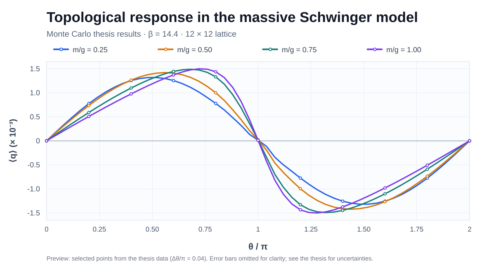

# Monte Carlo simulation of the dual Schwinger model

[Versión en español](README_ES.md)

C implementation of Monte Carlo updates for a dual monomer–dimer–loop representation of the **Schwinger model in 1+1 dimensions**, developed as part of a Bachelor's thesis in Physics at the University of Zaragoza (2025–2026).

The project investigates how gauge and fermionic observables depend on the fermion mass, coupling and topological angle. The dual representation uses plaquette occupation numbers, fermionic loops, dimers and (for nonzero mass) monomers. Negative weights in the massive case are handled through sign reweighting in subsequent analysis.

> **Research software:** This repository contains simulation code. The numerical implementation and its scientific interpretation should be assessed together with the thesis; a successful build alone is not a validation of the Monte Carlo results.

## Representative thesis result



*Illustrative plot from the bachelor's thesis data: topological-response density versus θ/π, for four values of m/g, at β = 14.4 and V = 12 × 12. To keep the overview readable, only every second point is shown and the uncertainty bars are omitted; see the full thesis for uncertainties and interpretation. [Preview data](docs/data/topological_response_preview.csv). These are thesis results, not a validation run of the exact default configuration in this repository.*

## Implementation

- Local plaquette updates and open/closed worm updates.
- Measurements of plaquette, dimer density, topological-response estimator, monomer density and chiral-condensate estimator.
- Per-configuration sign and sign-weighted measurements written to text files.
- Thermalisation records and parameter sweeps.

The code currently builds for **Windows with Visual Studio 2022 / MSVC**. It uses Windows-specific routines, including `rand_s`, `_mkdir`, and `Sleep`; Linux/macOS builds are **not** supported by this version.

## Build (Windows)

Install **Visual Studio 2022 with Desktop development with C++** (including the MSVC C compiler and Windows SDK) and **CMake 3.20+**.

Open a Developer PowerShell or Developer Command Prompt, at the repository root:

```powershell
cmake -S . -B build -G "Visual Studio 17 2022" -A x64
cmake --build build --config Release
```

The executable will be at `build/Release/SchwingerWorm.exe`. Run it **from the repository root** so that the output files are written to `Results/`:

```powershell
.\build\Release\SchwingerWorm.exe
```

**Important:** The current `src/Main.c` is *not* menu-driven. Running the executable starts the configured parameter sweep immediately; the default production settings are expensive.

## Current default run

Parameters are set in `src/Main.c` and lattice dimensions in `include/Lattice.h`. At the time of writing, the checked-in defaults are:

| Setting | Value |
| --- | --- |
| Lattice | `Nx = Nt = 10` (in `include/Lattice.h`) |
| Gauge coupling | `beta = 10` |
| Fermion mass | `m/g = 1` |
| Topological angle | `theta/pi = 0, 0.25, ..., 2` |
| Thermalisation | 100,000 Monte Carlo steps **per parameter point** |
| Measurements | 50,176 per parameter point |
| Steps between measurements | 10 |

To run a smaller experiment, **edit the constants in `src/Main.c` and rebuild**. One Monte Carlo step consists of a plaquette sweep, `max(1, V/10)` worm attempts and a second plaquette sweep.

The pseudo-random-number generator is seeded with the current time. The executable does **not** currently expose a fixed-seed option, so bit-for-bit reproducibility across runs is not guaranteed. The measurements are output as raw numerical samples, not as a final jackknife analysis.

## Output

When executed from the repository root, the program creates a `Results/` directory and writes:

- `Series_*.dat`: simulation metadata; one row per measurement containing the Monte Carlo step, ten observables, configuration sign and ten sign-weighted observables.
- `Thermalization_*.txt`: time-series records for the average plaquette and dimer density, sampled during thermalisation.

The sign-weighted columns permit reweighting; statistical uncertainties and nonlinear observables require appropriate separate post-processing. The topological-response code reports `q` and `q^2`; these should not automatically be interpreted as a complete estimator of the free-energy curvature susceptibility without its explicit derivative contribution.

## Repository layout

```text
.
├── CMakeLists.txt
├── include/
│   └── Lattice.h
├── src/
│   ├── Main.c
│   ├── Initializer.c
│   ├── UpdCore.c
│   ├── Plaq_mod.c
│   ├── Worm_ferm.c
│   ├── Measures.c
│   ├── Visualizer.c
│   └── Other.c
└── README_ES.md
```

## Thesis and scope

**Worm Algorithms for the Schwinger Model**, Bachelor's thesis in Physics, University of Zaragoza (2025–2026). The repository does not yet include the thesis PDF or the full set of figures. Links to public institutional or arXiv records can be added once available.

This work is based on established dual lattice formulations; the repository documents the implementation and numerical investigation, not a claim to have introduced the dual representation itself.
