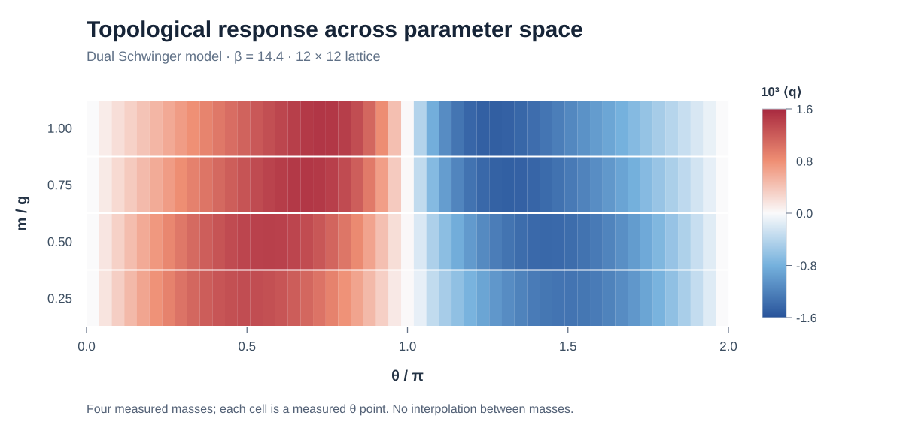

# Simulación Monte Carlo del modelo de Schwinger

[English](README.md) · [Código fuente](src/) · [Compilación y prueba](.github/workflows/windows-build.yml)

**Implementación en C de algoritmos Monte Carlo para el modelo de Schwinger en (1+1) dimensiones, en su formulación dual de monómeros, dímeros y lazos.** El proyecto se desarrolló como parte de un Trabajo de Fin de Grado en Física de la Universidad de Zaragoza (2025–2026) y estudia observables gauge y fermiónicos en función de la masa, el acoplamiento y el ángulo topológico.

## Resultado representativo



*Estimador de la respuesta topológica ⟨q⟩ frente a θ/π y m/g, para β = 14,4 y una red de 12 × 12. Cada celda representa un ángulo muestreado para una de las cuatro masas discretas; **no se interpola entre masas**. La figura procede de [datos redondeados del TFG](docs/data/topological_response_preview.csv). Se omiten las barras de incertidumbre en esta vista general; la memoria contiene el análisis estadístico y la interpretación física. No corresponde al barrido predeterminado del código publicado actualmente.*

## Características principales

- **Formulación dual:** números de ocupación de plaqueta, lazos fermiónicos, dímeros y monómeros.
- **Actualizaciones Monte Carlo:** movimientos locales de plaqueta y algoritmos de gusano abierto y cerrado.
- **Observables:** plaqueta, densidades de dímeros y monómeros, estimador de respuesta topológica y condensado quiral.
- **Reponderación del signo:** almacenamiento del signo y de los observables multiplicados por él para el posterior análisis.
- **Comprobaciones automáticas:** compilación mediante CMake y prueba reducida en Windows con GitHub Actions.

## Compilación y ejecución

**Entorno compatible:** Windows, Visual Studio 2022 con *Desarrollo para el escritorio con C++* (MSVC y SDK de Windows), y CMake ≥ 3.20. El código usa funciones específicas de Windows como `rand_s`, `_mkdir` y `Sleep`; esta versión no ofrece compatibilidad con Linux o macOS.

En una terminal de desarrollador de Visual Studio situada en la raíz:

```powershell
cmake -S . -B build -G "Visual Studio 17 2022" -A x64
cmake --build build --config Release
.\build\Release\SchwingerWorm.exe
```

**Importante:** el ejecutable comienza directamente el barrido de parámetros configurado en `src/Main.c`; **no** muestra un menú interactivo. Los parámetros originales requieren un tiempo de cálculo considerable.

### Parámetros predeterminados

| Parámetro | Valor |
| --- | --- |
| Tamaño del retículo | `Nx = Nt = 10` |
| Acoplamiento gauge | `β = 10` |
| Masa | `m/g = 1` |
| Ángulos topológicos | `θ/π = 0; 0,25; …; 2` |
| Termalización | 100 000 pasos Monte Carlo por punto |
| Medidas | 50 176 por punto |
| Separación entre medidas | 10 pasos |

Los parámetros y barridos se definen en [`src/Main.c`](src/Main.c) y las dimensiones de la red en [`include/Lattice.h`](include/Lattice.h). Para un experimento más corto, modifica las constantes y recompila. Un paso Monte Carlo comprende un barrido de plaquetas, `max(1, V/10)` intentos de gusano y un segundo barrido.

## Resultados generados

Al ejecutarlo desde la raíz se crea `Results/` con los siguientes archivos:

| Archivo | Contenido |
| --- | --- |
| `Series_*.dat` | Parámetros, paso Monte Carlo, diez observables, signo de configuración y diez observables multiplicados por el signo |
| `Thermalization_*.txt` | Evolución de la plaqueta media y la densidad de dímeros durante la termalización |

Son **medidas brutas**, no estimaciones estadísticas finales. En particular, los valores `q` y `q²` no constituyen por sí solos la susceptibilidad topológica definida por la curvatura de la energía libre: debe tenerse en cuenta su término de derivada explícita.

## Validación y reproducibilidad

El [flujo automático de Windows](.github/workflows/windows-build.yml) comprueba la compilación con MSVC y la ejecución de una **simulación acortada** sobre una copia temporal del código. Verifica que se obtienen medidas finitas y archivos con la estructura esperada; véase [`scripts/smoke-test.ps1`](scripts/smoke-test.ps1).

Es una **prueba técnica**, no una demostración de ergodicidad ni de corrección física de los resultados. El generador se inicializa actualmente con la hora del sistema y no ofrece una opción de semilla fija.

## Estructura

```text
include/       Cabeceras y parámetros del retículo
src/           Código C: actualizaciones, medidas, inicialización y salida
docs/data/     Datos redondeados de la figura del README
docs/figures/  Figuras ilustrativas
scripts/       Prueba corta aislada
CMakeLists.txt Compilación Windows/MSVC
```

## Contexto académico

Este repositorio acompaña **_Worm Algorithms for the Schwinger Model_**, Trabajo de Fin de Grado en Física, Universidad de Zaragoza (2025–2026). La formulación dual procede de trabajos previos de teoría de campos en el retículo; aquí se comparte su implementación y estudio numérico.

Se añadirá el enlace a la memoria completa en Zaguán o arXiv cuando esté disponible públicamente.
